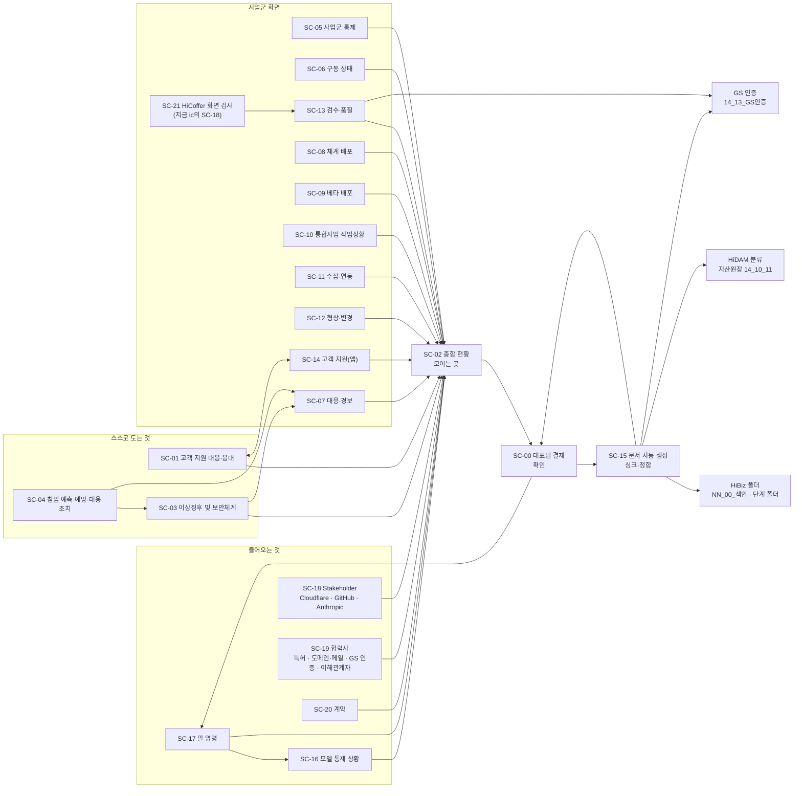

# HIVEN 자동화 통합 통제 화면 흐름 정의서

- 판: 0.1 작업본 · 만든 때 2026-11-13 · 만든 모델 Opus 5.5 · 검수 Fable
- 근거 지시: 대표님 2026-11-13 18:07~18:26(이력 1281~1292) → Fable 지시 · 덧붙임 지시 1(SC-18 Stakeholder) · 덧붙임 지시 2(SC-18·SC-19·SC-20 셋으로 나눔, HiCoffer 화면 검사는 SC-21로)
- 근거 자료(고치지 않고 씀): `cowork/ctl/sc_structure.tsv` · `aics_scmap.tsv` · `doc_rules.tsv`(DR-01~15) · `doc_life.tsv`(L1~L7) · `aics_doccheck.tsv`(K01~K15) · `alerts.tsv` · `free_tier_policy.tsv` · `model_control_history.tsv`
- 실측: 본판 `index.html`을 로컬 서버와 Playwright로 열어(바깥 호출은 모두 막음) 화면 18개를 차례로 띄우고, 화면마다 읽은 원천과 그 요청을 만든 코드 줄, 누르는 길, 깜빡이는 장치를 받아 적었습니다. 코드 줄 번호는 2026-11-13 18시 무렵 저장소 기준입니다(측정 중에 views5.js가 다른 작업으로 바뀌어 SC-15가 `aics_testgate.tsv`를 더 읽기 시작한 것을 3회차에서 보았습니다).
- 함께 낸 것: `HIVEN_자동화_통합_통제_화면_연결표-261113_0.1_작업.tsv`(FL-001~FL-083) · `HIVEN_원천_미연결_화면_이음_설계-261113_0.1_작업.md` · `HIVEN_사이트_페이지_연결표-261113_0.1_작업.tsv`(PG-001~PG-059)
- 화면 코드는 고치지 않았습니다.

## 0. 읽는 법 — 화면 함수는 여러 겹으로 덮인다

`index.html`은 스크립트를 이 순서로 읽습니다: data.js → views1 → views2 → views3 → views4 → views0 → views5 → views6 → views7 → views8 → views9 → sec → sec2 → app → sched-core → sched-alert → id-recheck. 뒤에서 읽은 파일이 같은 화면 함수(`V['SC-xx']`)를 다시 정의하거나 감쌉니다. 이 정의서의 「지금 코드가 하는 것」은 마지막에 남는 함수 기준입니다.

| 화면 | 마지막에 남는 함수(바깥 겹 → 안 겹) |
|---|---|
| SC-00 | id-recheck.js 32줄 → sched-alert.js 21줄 → views9.js 190줄 |
| SC-01 | views9.js 215줄 |
| SC-02 | sec2.js 70줄 → views9.js 179줄 → views0.js 56줄 (views1.js 1줄은 덮임) |
| SC-03 | views8.js 8줄 → views7.js 225줄 |
| SC-04 | sec.js 79줄 → sec.js 59줄 |
| SC-05 · SC-06 · SC-07 · SC-11 | views0.js 104 · 110 · 133 · 120줄 (views1·views2의 시험판 정의는 덮임) |
| SC-08 · SC-12 · SC-13 · SC-14 · SC-15 | views5.js 22 · 52 · 45 · 25 · 7줄 |
| SC-09 | views6.js 34줄 |
| SC-10 | views0.js 202줄 → views2.js 55줄 |
| SC-16 | views9.js 180줄 → views0.js 202줄 → views3.js 9줄 |
| SC-17 | id-recheck.js 34줄 → views9.js 182줄 → views0.js 116줄 |

모든 화면 아래에는 SC-01 연동 줄(views9.js 219~220줄)이 1초마다 붙고, 머리띠에는 결재 대기 버튼(views9.js 188줄)과 고객 지원 버튼(views9.js 226줄)이 모든 화면에 뜹니다.

## 1. 전체 구조도

선 하나가 연결표의 FL 줄 하나 이상입니다. 지금 코드에 실제로 있는 선은 「SC-16 → SC-02」, 「SC-03 → SC-02(한 기기 기준)」, 「SC-13 → SC-02(qa_checks만)」, 「SC-10 → SC-02(기한 임박만)」, 「SC-01 → 머리띠」뿐이고, 나머지는 일부이거나 없습니다(연결표 「지금 상태」 칸: 있음 26 · 일부 20 · 없음 35 · 어긋남 2).

## 2. 화면별 정의

각 절은 ① 역할 ② 받는 것 ③ 넘기는 곳 ④ 화면에 차례로 보여야 하는 것 ⑤ 지금 코드가 하는 것 ⑥ 어긋나는 점 순서입니다. 「원천」은 `cowork/ctl/` 아래 파일입니다.

### SC-00 대표님 결재

① 역할: SC-02에 모인 상황 중 대표님 확인·허가·승인이 필요한 것을 한곳에서 결재하고, 결재 결과를 문서(SC-15)와 지시(SC-17)로 넘깁니다. HiBiz `91_Claude_소통(COM)\91_02_지시문` · HiDAM 「HB-COM 지시·결재」 · DR-15.
② 받는 것: SC-02의 결재 올림(지금은 `approval_line.tsv` 80줄을 도구 gen_alerts.py · pledge_resign.py와 모델이 직접 씀) · 일정(`sched.enc.json`) · 신분 재확인(`id_recheck_hold.tsv` 0줄) · 일정 대장(`schedule_master.tsv` 26줄) · 각서·서명(`pledge_resign.tsv` 189줄) · 결재 결과(ic `/__sec/list`의 「신분 확인 통과(창 9xxxxx·8xxxxx)」 기록).
③ 넘기는 곳: SC-15(결재 기록 문서) · SC-17(지시 상태).
④ 차례로 보여야 하는 것: (1) 신분 재확인 줄 (2) 일정 얼럿 줄 (3) 결재 대기 — 종류별(허가 · 승인 · 확인)로 나눔, 가장 오래 기다린 것 먼저 (4) 줄마다 근거 화면으로 가는 길(이력 번호 → SC-16, CS 번호 → SC-01, 말 명령 → SC-17) (5) 결재한 것과 그 기록이 문서로 내려갔는지(SC-15 자리) (6) 각서·서명 대장 · 일정 대장.
⑤ 지금 코드: 제목·안내(views9.js 190줄) 아래에 일정 줄(sched-alert.js 21줄, 누르면 schedule.html) · 신분 재확인 줄(id-recheck.js 32줄) · 결재함 표 alBox와 각서 허가 표 pBox(views9.js 189~190줄) · 일정 대장·각서 서명 대장 smBox(views9.js 230~236줄, 60초마다·숨긴 탭 제외). 결재 결과는 ic `/__sec/list`를 페이지 열 때 한 번, 그 뒤 300초마다 한 탭에서만 읽음(views9.js 69 · 76줄). 결재 줄에 마우스를 올리면 팝업(views9.js 243~253줄). 머리띠 결재 버튼은 대기 건수로 주황 깜빡임(views9.js 186 · 188줄). 실측: 머리띠 「대기 55건」.
⑥ 어긋남: (가) 결재 결과가 Cloudflare 기록에만 있고 저장소·HiBiz 문서로 내려가지 않음(FL-026). (나) 대기 55건 대부분이 「확인 대기 · 작업은 진행 중(결재를 기다리지 않음)」 줄(approval_line.tsv 상태 칸 54줄)이라 허가·승인 대기와 섞여 깜빡임이 늘 켜짐. (다) 결재 줄에서 근거 화면으로 가는 길이 없음(FL-062). (라) SC-02에서 결재로 올리는 동작이 화면에 없음(FL-025).

### SC-01 고객 지원 대응·응대

① 역할: contact@hiven.co.kr(투자·협력·후원)와 assist@hiven.ai.kr(고객 지원)로 들어온 메일을 선대응 후 응대. HiBiz `40_HIVEN_고객지원(CS)` · 「HB-CS 접수·사례」 · DR-07 · DR-08.
② 받는 것: `cs_tickets.tsv`(8줄, Gmail 연결로 모델이 분류·갱신) · `cs_links.tsv`(17줄 연동 기준).
③ 넘기는 곳: SC-02 · SC-14 · SC-00(회신 허가) · SC-04(보안 건) · SC-16(담당 모델).
④ 차례: (1) 얼럿(선대응 필요 · 응답 기한 넘김) (2) 받는 주소별 건수 (3) 처리 순서 ①접수 → ⑥종결 (4) 접수 대장(최신순) (5) 결재 번호와 1:1 대조 (6) 연동 표.
⑤ 지금 코드: views9.js 208~215줄. 열린 건이 있으면 빨강 테두리 얼럿 카드와 깜빡이는 LED(209줄), 없으면 초록 「얼럿 없음」. 머리띠 고객 지원 버튼(226줄, 2초마다 다시 그림 216줄). 연관 화면 버튼과 전체 연동 표(212 · 214줄, 실측: SC-00 · SC-02~SC-17 17개 화면으로 가는 버튼). 지금 열린 건 0.
⑥ 어긋남: (가) 응답 기한 칸이 cs_tickets.tsv에 없음(앱 쪽 aics_cs_cases.tsv에는 있으나 0줄) — 기한 얼럿을 만들 수 없음. (나) SC-14와 원장이 둘(FL-007). (다) CS 번호 ↔ 결재 번호 칸 없음(FL-036). (라) SC-18~SC-20 줄이 연동 표에 없음.

### SC-02 종합 현황

① 역할: 들어오는 것 · 스스로 도는 것 · 사업군 화면을 한 판에 모아 무엇이 열려 있고 무엇을 결재로 올릴지 보이는 곳. HiBiz `04_HIVEN_컨트롤타워_AICS(HCT)` · 「HB-HCT 현황」 · DR-11.
② 받는 것(있어야 할 것): SC-01 · SC-03 · SC-04 · SC-05~SC-14 · SC-16 · SC-17 · SC-18 · SC-19 · SC-20.
③ 넘기는 곳: SC-00.
④ 차례: (1) 위기대응 배너와 이상징후 단계 (2) 지금 열린 얼럿 묶음 — 종류별 건수 한 줄(침입 · 이상징후 · 고객 지원 · 모델 통제 · 문서 규칙 · 말 명령 · 일정 · 바깥 기반 · 협의 기한 · 계약 만료) (3) 핵심 다섯 상자(장애 · 위험 · 자가 검수 · 조치 중 · 조치 완료) (4) 화면별 상자(SC-01 · SC-03~SC-14 · SC-16~SC-20, 누르면 그 화면) (5) 결재로 올릴 것 → SC-00 (6) 조치 생명주기 7단계 (7) 상자별 표.
⑤ 지금 코드: 맨 위 이상징후 단계 상자·배너(sec2.js 65~70줄, 이 기기 localStorage 기준) → 지시·실행 체계 카드(views9.js 176 · 179줄) → 차단 경보(views0.js 41~46줄, model_control_index.json) → 핵심 다섯 상자(views0.js 70~75줄, 모델통제 이력 · action_lifecycle · qa_checks · progress.json) → 여섯 상자(경보 · AICS · HIVEN.app · HiClo 판정·구동, views0.js 77~78줄, HVR 옛 값) → 생명주기 → 장애 경로(views0.js 31~37줄, 코드에 적은 두 건) → 추이 그래프 → 3대 원칙 이행 · 원천 신선도(views9.js 179줄) → 상자별 표 11개 → 모델 통제 요약 → 요약 넷(views0.js 199줄). 실측: 화면 요소 18,054개, 글자 11,769자, 「확인 안 됨」 6곳, 「원천 없음」 3곳. 누르는 길: SC-01 · SC-03 · SC-16, 상자 근거 안에서 SC-06 · SC-07.
⑥ 어긋남: (가) SC-01 · SC-05 · SC-08 · SC-09 · SC-12 · SC-14 · SC-15 · SC-17이 SC-02에 들어오지 않음(FL-002 · 006 · 008 · 013 · 016 · 017 · 020 · 030). (나) 「경보」 상자가 경보 원장(alerts.tsv 106줄)이 아니라 11-03 판정값 4줄(FL-015). (다) 「위험 요소」 안 재발 위험 3줄(RISK)과 장애 경로 2건이 코드에 적은 값(views0.js 31~37 · 68줄). (라) 모델통제 이력 파일을 이 화면이 따로 또 읽음(성능 8절). (마) 원천이 다시 읽히면 화면 전체를 다시 그림(views0.js 54줄 `render('SC-02')`).

### SC-03 이상징후 및 보안체계 시스템

① 역할: HIVEN 전체 경로의 이상징후를 12단계로 발령하고 매뉴얼 7종의 행동을 지시. SC-04의 상위 체계. HiBiz `31_HIVEN_이상징후_및_보안체계(SEC)` · 「HB-SEC 경보·매뉴얼」 · DR-07 · DR-13.
② 받는 것: SC-04 침입 기록 · 사이트 이상 접속(sec-lite.js) · 무결성 검사 · 사업군 접점 신호.
③ 넘기는 곳: SC-02 · SC-07 · SC-00(단계 6 이상).
④ 차례: (1) 지금 발령 단계와 근거(어느 기록에서) (2) 지금 단계에서 매뉴얼 7종이 할 일 (3) 열린 이상징후 목록 (4) 등급 대응표 (5) 체계·매뉴얼 기준 문서(접어 둠).
⑤ 지금 코드: 체계 표 22개(views7.js 225~250줄, 코드 안 배열 hvEM) + 매뉴얼 7종·비상체계·벤치마킹(views8.js 8~29줄, manuals.json을 구워 넣은 hvMAN) + 지금 발령 단계의 행동(views8.js 31~35줄, 3초마다, 단계는 sec2.js `hvEmLevel` = 이 기기 열쇠 오류 수). 역정합 검사(views7.js 183~190줄)는 이 화면에서 실시간 대조. 실측: 글자 34,148자, 「확인 안 됨」 11곳. 누르는 길: SC-01뿐.
⑥ 어긋남: (가) 단계가 이 기기 기록만 봄 — 다른 기기·서버 기록은 단계에 안 들어감(FL-009 · 010). (나) 지금 발령·열린 이상징후가 34,000자 기준 문서 사이 한 칸(hvlive)에 묻혀 있음 — 차례 (1)~(3)이 맨 위에 와야 함. (다) SC-04로 가는 버튼 없음(FL-064). (라) 등급 체계 다섯 가지 중 CR · M · K 칸이 「정할 것」(views7.js 197줄).

### SC-04 침입 예측·예방·대응·조치 시스템

① 역할: 열쇠 입력 · 우회 · 변조 · 복제 · 삽입 · 없는 경로 접근을 등급으로 기록·경보·잠금. HiBiz 31 · 「HB-SEC 침입 기록」 · DR-14.
② 받는 것: 인트로 열쇠 입력(app.js) · sec-lite.js(세 사이트 공통) · 무결성 불일치(sec2.js 76~79줄) · ic 서버 기록.
③ 넘기는 곳: SC-03 · SC-02 · SC-07.
④ 차례: (1) 지금 등급·잠금 (2) 통합 경보(서버, 최신순) (3) 이 기기 경보 (4) 신뢰 기기 (5) 기준표.
⑤ 지금 코드: sec.js 59~79줄. 화면을 열 때마다 ic `/__sec/me` · `/__sec/list?n=1000` · `/__dev/list`를 부름(sec.js 57 · 58 · 77줄). 열쇠 오류는 이 기기 localStorage에 쓰고 ic `/__sec`로 보냄(sec.js 12 · 15줄). 열쇠 통과 기록 없이 입장 표식만 있으면 「우회 의심」 위기 등급(sec.js 27줄).
⑥ 어긋남: (가) aics_scmap의 「원천에 안 이어짐」은 시험 페이지(sec.js 안 읽음)에서 잰 탓 — 실제로는 서버 원천에 이어짐(이음 설계 1절). (나) 공개 주소 본판에서 열 때마다 Cloudflare 호출 3건. (다) 침입 경보가 경보 원장(alerts.tsv)에 들어가지 않음(FL-012).

### SC-05 사업군 통제

① 역할: 7사업군 × 생명주기 7단계와 사업군 접점 30건. HiBiz `06_HIVEN_통합사업(HV)` · 11~17 · 「HB-BIZ 사업군 산출물」 · DR-10.
② 받는 것: `bg_lifecycle.tsv`(0줄) · `bg_contact.tsv`(30줄) · `bg_source.tsv`(7줄) · 코드 안 BG 배열(data.js 13~21줄).
③ 넘기는 곳: SC-02.
④ 차례: (1) 사업군별 열린 감지 건 (2) 7×7 표 (3) 접점 기준 (4) 접점 표.
⑤ 지금 코드: views0.js 104~109줄, 원천은 페이지 전체가 30초마다 미리 읽는 hvMeta(views0.js 173 · 200줄). 사업군 상태 「정상·구성 중」은 코드 값(data.js BG).
⑥ 어긋남: 생명주기 원천 0줄이라 7×7 표가 모두 0(실측 0인지 원천 연결 전인지 구분 문구는 있음). SC-02에 사업군 상자 없음(FL-013).

### SC-06 구동 상태

① 역할: HiClo.app · HIVEN.app · AICS · 설치본이 실제로 돌고 있는지. HiBiz `04_HCT\04_21` · 「HB-HCT 구동 신호」 · DR-14.
② 받는 것(있어야 할 것): 구동 신호 원천(이음 설계 5절 `run_signal.tsv`).
③ 넘기는 곳: SC-02.
④ 차례: (1) 대상별 지금 구동 · 마지막 신호 · 정지 시간 (2) 저장 주기 (3) 작업 대기열 마지막 결과.
⑤ 지금 코드: views0.js 110~115줄, 모든 값이 HVR(views0.js 4~16줄, 11-04 15:56 확인).
⑥ 어긋남: 원천 없음(맞음). HiClo 판정이 11-03 20:54 뒤 멈춤 — alerts.tsv AL-001, 결재 A-008.

### SC-07 대응·경보

① 역할: 모든 경보를 한 원장(alerts.tsv)으로 모아 규칙(CR)·등급·조치 상태로 봄. HiBiz 31 · 「HB-SEC 경보」 · DR-07.
② 받는 것: `alerts.tsv`(106줄: CR-01 원천 정지 1 · CR-02 지시 거부 97 · CR-03 지시자 호출 8 / 미조치 16 · 조치 중 90, `tools/gen_alerts.py`가 커밋마다 만듦).
③ 넘기는 곳: SC-02.
④ 차례: (1) 미조치 경보 (2) 조치 중 (3) 해제 (4) 규칙별 건수.
⑤ 지금 코드: views0.js 133~144줄. 경보 원장 표 + HVR 옛 값 표. 클로 단계·대응 모드 카드는 HVR · 「확인 안 됨」.
⑥ 어긋남: 침입 경보 · 문서 얼럿 · 유휴 · 바깥 기반이 원장에 없음. SC-02 「경보」 상자가 이 원장을 안 씀(FL-015). 원장 줄에서 근거 화면으로 가는 길 없음(FL-066).

### SC-08 체계 배포

① 역할: 분류·규칙 문서의 최종본·작업본 판 배포 현황. HiBiz `07_STD` · `14_HiDAM\14_01` · 「HiDAM 표준·분류 체계」 · DR-08 · DR-09.
② 받는 것: `aics_deploy.tsv`(10줄, gen_aics_src.py, 마지막 갱신 11-05).
③ 넘기는 곳: SC-02 · SC-15.
④ 차례: (1) 판 불일치 (2) 배포 목록.
⑤ 지금 코드: views5.js 22줄(공통 부품 hv5, 4줄 — 열 때 한 번 읽음).
⑥ 어긋남: 원천이 11-05 뒤 갱신 없음. SC-02로 안 감(FL-016).

### SC-09 베타 배포 모니터링

① 역할: HiCoffer PC 베타 1·2·3의 게이트와 배포 뒤 사건, 판별 내려받기 수. HiBiz `12_HiCoffer\12_06 · 12_10` · 「HB-BIZ 06·10」 · DR-10 · DR-14.
② 받는 것: `deploy_beta1_gates.tsv`(11줄) · `deploy_beta1_events.tsv`(1줄) — 둘 다 손으로 씀 · 내려받기 기록 ic `/__sec/dl`(views6.js 17줄).
③ 넘기는 곳: SC-02 · SC-14(배포 뒤 문의).
④ 차례: (1) 미통과 게이트 (2) 배포 뒤 미조치 사건 (3) 내려받기 (4) 추이.
⑤ 지금 코드: views6.js 2~34줄. 베타 2·3은 「시작 전」 고정 글.
⑥ 어긋남: 게이트 결과가 증적 번호와 이어지지 않고 손으로 씀. SC-02 · SC-14로 안 감(FL-017 · 067).

### SC-10 통합사업 작업상황

① 역할: 계층 진척(T~MM) · 일일보고 · 변경 로그. HiBiz `06_HV` · `94_Claude_Fable` · 「HB-HV 계획·보고」 · DR-07.
② 받는 것: `cowork/progress.json` · `cowork/reports/index.json` · `cowork/log.tsv`(38줄).
③ 넘기는 곳: SC-02.
④ 차례: (1) 기한 임박 (2) 진척 (3) 보고.
⑤ 지금 코드: views2.js 55~67줄, 30초마다 다시 읽음(views2.js 61줄).
⑥ 어긋남: 원천 progress.json은 노트북에서 받은 진행상황판을 gen_meta.py가 옮긴 것이라, 모델이 받지 않으면 갱신이 멈춤(마지막 12:21).

### SC-11 수집·연동

① 역할: 원천마다 마지막으로 언제 들어왔는지 — 「이 데이터가 왜 안 들어와 있지」를 찾는 화면. HiBiz `09_CFG\09_24` · 「HB-CFG 자동화 통제」 · DR-11.
② 받는 것: `publish_meta.json`(gen_meta.py) · (있어야 할 것) `source_freshness.tsv`.
③ 넘기는 곳: SC-02 · 머리띠 신선도 칩.
④ 차례: (1) 끊긴 원천 (2) 원천별 마지막 수신과 화면 읽기 주기 (3) 게시 파일별 표.
⑤ 지금 코드: views0.js 120~131줄. 위 표는 HVR와 고정 글(「10초마다」 「30초마다」), 아래 표는 publish_meta.json.
⑥ 어긋남: 고정 글의 주기가 실제와 다름(이음 설계 7절). source_freshness.tsv(44줄)를 이 화면이 안 씀.

### SC-12 형상·변경

① 역할: 변경 기록·커밋·판. HiBiz `09_CFG` · 「HB-CFG 형상·변경」 · DR-08.
② 받는 것: `aics_changes.tsv`(254줄) · `aics_changes_timefix.tsv`(79줄).
③ 넘기는 곳: SC-02 · SC-15.
④ 차례: (1) 오늘 변경 · 되돌림 (2) 변경 목록 (3) 판 셋.
⑤ 지금 코드: views5.js 52줄. 실측: 「원천 없음」 4곳(판 셋 「자리만」).
⑥ 어긋남: SC-02로 안 감(FL-020).

### SC-13 검수·품질

① 역할: 자동 검수 결과 · 결함 대장 · GS 자가 점검. HiBiz `09_CFG\09_23` · `NN_07_품질검수` · 「HB-BIZ 07 · GS 자가 점검」 · DR-10 · DR-12.
② 받는 것: `aics_qa.tsv`(290줄) · (SC-02 쪽) `qa_checks.tsv`(16줄) · SC-21 화면 검사 결과(있어야 할 것).
③ 넘기는 곳: SC-02 · SC-15 · GS 인증(14_13).
④ 차례: (1) 열린 결함 (2) 자동 검수 (3) GS 조건 대조.
⑤ 지금 코드: views5.js 45줄.
⑥ 어긋남: SC-02는 qa_checks.tsv만 보고 aics_qa.tsv의 열린 결함은 안 셈. GS 조건표와 이어지는 칸 없음(K13 얼럿 3건).

### SC-14 고객 지원(앱)

① 역할: 앱 안 문의 · 기기 · 정합 · 미러링 · 복구 사례 원장과 응답 기한. HiBiz 40 · 「HB-CS 사례 원장」 · DR-07.
② 받는 것: `aics_cs_cases.tsv`(0줄, 「응답 기한」 칸 있음).
③ 넘기는 곳: SC-02 · SC-01.
④ 차례: (1) 기한 넘김 (2) 열린 사례 (3) 여덟 숫자.
⑤ 지금 코드: views5.js 25~42줄. 실측: 「확인 안 됨」 9곳.
⑥ 어긋남: SC-01 원장과 따로(FL-007). aics_scmap이 이 화면을 deploy_beta1_gates.tsv와 짝지은 것은 잘못(이음 설계 8-3).

### SC-15 문서 자동 생성

① 역할: 모든 화면의 원천과 HiBiz 실측을 문서 규칙(DR)으로 대조해 색인·문서를 만들고 싱크·정합. HiBiz `07_STD` · 폴더마다 `NN_00_색인` · 「HiDAM 자산원장 · HB-BIZ · GS 조건표」 · DR-01~15.
② 받는 것: `aics_docfolder.tsv` · `aics_doccheck.tsv`(K01~K15) · `doc_rules.tsv` · `doc_life.tsv` · `aics_docgen.tsv` · `aics_docsync.tsv` · `aics_scmap.tsv`(측정 3회차부터 `aics_testgate.tsv`도).
③ 넘기는 곳: HiBiz 폴더(색인 · 펼침표) · SC-00(문서 얼럿 확인) · HiDAM · GS.
④ 차례: (1) 얼럿(K 등급 「얼럿」) (2) 실측 싱크(새로 생긴 규칙 밖 파일) (3) 검사 결과 (4) 폴더별 (5) 화면 × 문서 연결표 (6) 규칙표 · 생애 절차 (7) 게시 문서.
⑤ 지금 코드: views5.js 7~21줄. 열 때 한 번 읽음. 실측: 얼럿 등급 합계는 K01 1 · K07 103 · K08 5 · K13 3 · K14 1 · K15 3(K04 0).
⑥ 어긋남: (가) 화면은 표시만 하고 「생성」은 화면 밖 도구(hibiz_doc_check.py · gen_aics_src.py). (나) K 얼럿이 SC-02 · SC-00 · 머리띠로 가지 않음(FL-029 · 030 · 042). (다) DR-15 한 줄기 여섯 자리 대조가 이력 번호별로 보이지 않음(FL-003).

### SC-16 모델 통제 상황

① 역할: 모델통제 이력 · 생명주기 · 지시 추적 · 지시 거부 지속 얼럿 · 지시자 호출. HiBiz `91_COM\91_21_모델통제(CTL)` · 「HB-COM 모델통제」 · DR-15.
② 받는 것: `model_control_history.tsv`(1,121줄) · `model_control_index.json` · `model_control_status.tsv` · `trace_v.tsv`(810줄) · `trace_h.tsv` · `trace_sum.json` · `phrase_scan.json` · `praise_*` · (있어야 할 것) `model_calls.tsv`.
③ 넘기는 곳: SC-02 · SC-15 · SC-17.
④ 차례: (1) 지시 거부 지속 얼럿 · 지시자 호출 (2) 유휴 (3) 모델별 지수 (4) 이력(최신순) (5) 분석.
⑤ 지금 코드: views3.js 9줄 본체, 원천 9개를 10초마다 다시 읽음(views3.js 16 · 20~26줄). 맨 위에 지시·실행 체계 카드와 얼럿 상자(views9.js 180줄, alertBox 153줄). 실측: 글자 31,987자.
⑥ 어긋남: (가) model_calls.tsv를 읽는 화면이 없음(FL-039). (나) 유휴 5분 얼럿 장치 없음(FL-040). (다) 이력 파일을 이 화면 10초 주기와 페이지 전체 1초 주기로 두 번 읽음.

### SC-17 말 명령

① 역할: 대표님 말 명령이 이력 → 대장 → 대표 지시 장 → 아티팩트 둘 → 메모리로 빠짐없이 들어갔는지(DR-15). HiBiz `91_02_01_대표지시` · 「HB-COM 대표 지시」.
② 받는 것: `trace_v.tsv` · `command_ledger.tsv`(519줄) · 이력 · `ceo_orders/*.txt` · `id_recheck_hold.tsv` · 각서·서명 원천(pledge_*).
③ 넘기는 곳: SC-16 · SC-02 · SC-15.
④ 차례: (1) 오늘 말 명령(최신순)과 대장 대조 (2) 문서 빠짐(대장 없음 · K15) (3) 신분 재확인 보류 (4) 각서·서명·지표.
⑤ 지금 코드: 말 명령 표(views0.js 188~195줄, 「대장 없음」 태그 194줄) → 신분 재확인 줄(id-recheck.js 34줄) → 각서·지표(views9.js 182줄). 말 명령 접수 상자는 지웠으나(views9.js 171줄 `cmdBox` 빈 글) 접수 목록 호출 `cmdLoad()`는 페이지를 열 때마다 한 번 ic `/__cmd/list`를 부름(views9.js 173줄).
⑥ 어긋남: (가) 문서 빠짐이 이 화면 안 태그뿐(FL-043). (나) 쓰지 않는 ic 호출이 남음.

## 3. 새로 넣는 화면 — SC-18 · SC-19 · SC-20 · SC-21

대표님 18:22 · 18:26 지시(이력 1290 · 1292). 고객 지원(SC-01 · SC-14)은 고객 → 우리 방향이고, 이 셋은 바깥 상대 → 우리 방향입니다. 세 화면 모두 SC-02 → SC-00 → SC-15로 잇습니다. 지금 코드는 없습니다.

### 3-1. SC-18 Stakeholder — 우리 시스템이 올라타 있는 곳

메뉴 이름은 「Stakeholder」 그대로 씁니다.

**상대 목록(저장소·문서 근거가 있는 것만)**

| 번호 | 상대 | 맡긴 일 | 우리 쪽 자리(근거) | 연락 길 | 요금·한도 |
|---|---|---|---|---|---|
| ST-01 | Cloudflare | ic.hiven.ai.kr 작업자(로그인 통제 Access · 침입 경보 · 결재 결과 · 말 명령 접수 · 신뢰 기기 · 호출 집계 저장소 Durable Object SecLog) · hiven.co.kr/assets/download/* 내려받기 기록 | hiven-ic `wrangler.jsonc`(작업자 이름 · 경로 둘 · 저장소 묶음) · `worker.js` 3 · 231 · 259 · 301줄 | 계정 대시보드 · 경고 메일(Gmail로 받음, 이력 1081). 계정 메일 주소는 확인 안 됨 | 무료(법인 설립 전 유료 금지, free_tier_policy.tsv · 이력 1110). 문서값(실측 아님): Durable Object 요청 하루 100,000 · Worker 요청 하루 100,000 · 행 읽기 5,000,000 · 행 쓰기 100,000 · 저장 5GB · 로그·빌드 한도 확인 안 됨. 배분: 고객 지원 60,000 · 보안·신분 10,000 · 내부 10,000 · 예비 20,000 |
| ST-02 | GitHub | hiven.ai.kr(hs 저장소, CNAME) · hiven.co.kr(hiven-site, README 「GitHub Pages로 게시」) 게시 · 세 저장소 원본 보관 | hs `CNAME` · hiven-site `CNAME` · `README.md` | 확인 안 됨 | 요금제 · Pages 한도 확인 안 됨 |
| ST-03 | Anthropic | 작업 모델(Fable · Opus · Sonnet) | 모델통제 이력 · `agent_usage.tsv` | Anthropic 지원 메일(ceo_schedule.tsv에 보낸 메일 기록) | 요금제 · 사용 한도 확인 안 됨 |
| (후보) | jsDelivr | 글꼴(Pretendard) 배포 | index.html 11줄 | — | 무료(확인 안 됨) · 장애 때 글꼴만 바뀜 |

**오늘 아침 Cloudflare 상황(근거: model_control_history.tsv 2026-11-13 줄)**

| 이력 | 때 | 내용 |
|---|---|---|
| 1075 | 09:07 | 대표님이 Cloudflare 계정 분석 화면을 보이며 뜻을 물으심 |
| 1081 | 09:28 | 「무료 티어 1일 10만 요청 초과」 · 유료 업그레이드 필요 여부 확인 지시. 조치: Gmail 경고 메일 3통(02:01 · 02:04 · 09:11) 읽음, 원인 후보로 저장소 코드(views9.js 1초 읽기 · worker.js 저장소 호출) 보고 |
| 1110 | 10:22 | 법인 설립 전 모든 유료 사항을 무료 안에서 홀딩 · 사용량 예측과 여유를 둔 무료 운영 정책 → free_tier_policy.tsv |
| 1153 | 12:07 | 호출 하루 10만 건 확인 지적. ic `/__quota` 12:08 실측: 단계 0(평시) · 누적 11건 · 한도 100,000 |
| 1243 | 16:32 | 일정 화면이 호출 몫에 영향을 주면 안 됨 — 이벤트가 생길 때만 한 번 |
| 1290 | 18:22 | 이 상황을 받는 화면이 없어 SC-18을 만듦 |

이 정의서를 쓰며 잰 사실: 본판은 열쇠를 넣기 전 인트로 화면에서도 ic를 세 번 부릅니다(`/__cmd/list` views9.js 173줄 · `/__sec/list` views9.js 76줄 · `/__dev/get` sec2.js 37줄 — 실측에서 막은 바깥 요청 4건 = 이 셋 + 글꼴). 저장소 파일 16개를 1초마다 읽는 것(views9.js 227줄)은 hiven.ai.kr(GitHub Pages)로 가는 요청이며, 이 요청이 Cloudflare를 거치는지는 확인 안 됨(DNS 설정이 저장소에 없음).

**협력사가 먼저 띄우는 얼럿과 대처 순서**

| 얼럿 | 받는 길 | 대처 순서 | 영향 받는 우리 화면 |
|---|---|---|---|
| Cloudflare 한도 임박·초과 | 경고 메일 · `/__quota` 단계 | ① `/__quota` 사본으로 단계 확인 ② 주기 호출 단계 올림(이미 작업자가 함: 평시 60초·300초 → 주의 300·900 → 경계 1,800, free_tier_policy.tsv) ③ 호출을 만드는 코드 찾기 ④ 유료 전환은 금지 — 결재로 올리지 않고 줄이는 쪽만 ⑤ 기록 | SC-04 · SC-00(결재 결과 읽기) · SC-17(접수) · SC-09(내려받기 수) · id.html(신분 확인) · SC-03(서버 기준 단계가 되면) |
| Cloudflare 장애 | 상태 페이지 · 메일 | ① ic 응답 확인(한 번) ② 영향 화면에 「바깥 기반 장애」 표시 ③ 공개 주소 본판은 저장소 사본으로 계속 ④ 회복 확인 ⑤ 기록 | SC-04 · SC-00 · SC-09 · SC-17 · ic 전체 |
| GitHub Pages 장애·게시 실패 | 메일 · 게시 확인 | ① 게시 확인 ② 원천 게시가 멈춘 시간 기록 ③ SC-11 「정지」 ④ 회복 뒤 게시본 대조 | hiven.ai.kr 전체(SC-00~SC-17 공개판) · hiven.co.kr · SC-11 |
| Anthropic 장애·사용 한도 | 화면 안내 · 메일 | ① 멈춘 작업과 시각 기록 ② SC-16 유휴와 구분(모델 잘못 아님) ③ 재개 순서 | SC-16 · SC-17 · SC-10 |
| 정책·약관 변경 · 요금 변경 · 만료 | 메일 | ① 원문 요지 기록(비밀 값 없이) ② 영향 판단 ③ 무료 운영 원칙에 맞는지 ④ 바뀌면 SC-20(계약)에 반영 | SC-20 · SC-02 |

**원천 파일 설계(새)**
- `cowork/ctl/stakeholder_list.tsv` — 칸: 번호(ST-nn) · 상대 · 화면(SC-18 · SC-19 · SC-20 · 이해관계자) · 맡긴 일 · 우리 쪽 자리(코드·설정 파일) · 연락 길 · 요금제 · 한도(문서값/실측 구분) · 영향 화면 · 근거 · 확인한 때.
- `cowork/ctl/stakeholder_alerts.tsv` — 칸: 번호(SA-nnnn) · 받은 때 · 보낸 곳 · 받은 길(메일 · 대시보드 · 상태 페이지 · /__quota) · 종류(장애 · 정책 변경 · 한도 임박 · 요금 · 만료) · 원문 요지 · 영향 화면 · 등급 · 대처 · 결재 번호 · 상태(미조치 · 조치 중 · 조치 완료) · 해제 때 · 기록 장 경로.
- 만드는 도구: `tools/gen_stakeholder.py`(새) — 모델이 메일과 `/__quota` 사본을 읽은 차례에 줄을 더함. 원문 근거 없는 줄은 넣지 않음.
- 흐름: SC-18 → SC-02(「바깥 기반」 상자) → SC-00(대처 중 결재가 필요한 것만) → SC-15 → HiBiz.
- HiBiz 원천 폴더 제안: `08_HIVEN_운영관리(OPS)\08_28_바깥_기반(Stakeholder)`(2층 내용 폴더, DR-05에 따라 13 이상 번호) · HiDAM 분류 제안: 「HB-OPS 바깥 기반」. 경보 원장(alerts.tsv)에 새 규칙 번호로 함께 올림.

### 3-2. SC-19 협력사 — 계약보다 앞서 준비·협의할 곳(이해관계자 갈래 포함)

**상대와 할 일(근거가 있는 것만)**

| 번호 | 상대 · 갈래 | 할 일 | 온라인 · 오프라인 | 근거 | 기한 |
|---|---|---|---|---|---|
| PT-01 | 특허청(상표) | 등록 상표 관리 · 새 상표 확보안 | 온라인(전자 출원·조회) · 오프라인 여부 확인 안 됨 | HiBiz `02_HIVE_브랜드_지식재산(BIP)\02_27`(상표 자산 확보안) · `02_28`(등록증·등록원부 원천 자료) | 갱신 기한 확인 안 됨(계산하지 않음) |
| PT-02 | 도메인 등록 업체(후이즈) | 등록 도메인 54개 관리 · 등록 가능 여부 확인 | 온라인 | HiBiz `02_BIP\02_06`(54개 현황 보고서) · `02_24`(등록 가능 여부 확인) · `02_25`(설정 확인 사항) | 도메인별 만료일 확인 안 됨 |
| PT-03 | 메일(contact@hiven.co.kr · assist@hiven.ai.kr) | 수신 · 분류(Gmail 연결) | 온라인 | cs_tickets.tsv 비고 · views9.js 206줄 | 메일 서비스 업체 · 계약 확인 안 됨 |
| PT-04 | GS 인증 시험기관 | 인증 준비 · 신청 | 온라인 신청 + 오프라인 제출·시험(세부 확인 안 됨) | `design/HIVEN_WBS_GS_인증_조건_전부-261113_0.2_작업.tsv`(TTA · KTL · KTC 이름이 수집본에 나옴, 어느 기관인지 정해지지 않음) · HiBiz `14_HiDAM\14_13_GS인증` | 외부 실행은 2027-03부터(메모리 「선행 구조」) |
| PT-05 | 서비스 수준 약속(SLA) | 약속값 정하기 | — | `sla_basis.tsv`(항목 4줄, 약속값 모두 「미정」, 실측 근거 0건) · `sla_basis.md` | 확인 안 됨 |
| PT-06 | 업무협약(MOU) | 협약 제안 | 오프라인 협의 필요(확인 안 됨) | HiBiz `12_HiCoffer\12_12_자료`의 MOU 제안안 1건(2026-10-30) — 제안안이며 체결 근거 없음 | 확인 안 됨 |
| 이해관계자 | 중소벤처기업부 · K-Startup(정부 지원) | 창업지원사업 통합공고 · 예비창업패키지 공고·신청 조건 감시 | 온라인 공고 | `watch_targets.tsv` WT-01 · WT-02 · HiBiz `10_HIVEN_정부지원사업(GOV)`(00_색인 · 12_자료뿐) | 공고 시점 확인 안 됨 |
| 이해관계자 | 법인 설립 관련 기관 | 법인 설립(2027-03 이후, 메모리) | 오프라인 포함 | 저장소 근거 없음 | 확인 안 됨 |

**화면 차례**: (1) 기한 7일 안 (2) 진행 중 협의(상대 · 할 일 · 다음 행동 · 누가) (3) 온라인으로 끝나는 것 / 오프라인 방문·서명이 필요한 것 (4) SLA · MOU 초안과 판 (5) 이해관계자 갈래(공고 감시).
**원천 파일 설계(새)**: `cowork/ctl/partners.tsv` — 칸: 번호(PT-nn) · 상대 · 갈래(특허·상표 · 도메인 · 메일 · 인증 · SLA · MOU · 이해관계자) · 할 일 · 온라인/오프라인 · 선행 조건 · 기한 · 하는 쪽(모델 준비 / 본인 확인 필요) · 진행 상태(준비 · 협의 · 합의 · 계약으로 넘김 · 멈춤) · 문서 자리(HiBiz 경로) · 결재 번호 · 근거 · 확인한 때.
**흐름**: SC-19 → SC-02(「협의 기한」 상자) → SC-00(합의·서명 전 결재) → SC-15(협의 기록 장) → 합의되면 SC-20.
**HiBiz 원천 폴더 제안**: `05_HIVEN_비즈정책(HIBP)\05_20_협력사_협의`(SLA · MOU 초안 · 협의 기록). 특허·상표·도메인 원천은 `02_BIP`, GS는 `14_13_GS인증`, 정부 지원은 `10_GOV`가 원천이고 05_20 색인에는 경로만 둡니다(DR-11 원천 한 곳 · DR-12). HiDAM 분류 제안: 「HB-HIBP 협력·협의」 · 이해관계자 「HB-GOV 정부 지원」.

### 3-3. SC-20 계약

**지금 있는 HIVEN 계약**: 없음(만들 것). 저장소·HiBiz 목록에서 HIVEN 사업 이름으로 맺은 계약서는 찾지 못했습니다. Cloudflare · GitHub · Anthropic은 약관 동의로 쓰고 있으며 동의 기록 문서가 저장소에 없음(만들 것). HiBiz에 대표 개인 명의 계약 문서 몇 건이 있으나 HIVEN 사업 계약이 아니라 이 화면에 싣지 않습니다. 우리가 고객에게 내는 약관(HiCoffer 이용약관 · 베타 이용약관 조항 초안, HiBiz `06_HV\06_01` · `06_08`)은 「고객 약관」 갈래로 둡니다.

**화면 차례**: (1) 만료 30일·7일 안 (2) 자동 갱신 예정 (3) 계약 목록(상대 · 갈래 · 기간 · 조건 요지 · 상태) (4) 고객 약관 판.
**원천 파일 설계(새)**: `cowork/ctl/contracts.tsv` — 칸: 번호(CT-nnn) · 상대 · 갈래(공급 · 이용 약관 동의 · 고객 약관 · 용역 · 협약) · 계약 이름 · 원본 자리(HiBiz 경로, 원본은 증적으로 이름·내용 불변 DR-14) · 맺은 때 · 시작 · 끝 · 갱신 방식 · 해지 통보 기한 · 요금·조건 요지 · 결재 번호 · 상태(초안 · 협의 · 체결 · 만료 · 해지) · 얼럿 기준 · 근거.
**흐름**: SC-20 → SC-02(「계약 만료」 상자) → SC-00(체결 · 갱신 · 해지 결재) → SC-15(계약 대장).
**HiBiz 원천 폴더 제안**: `05_HIVEN_비즈정책(HIBP)\05_21_계약`(법인 설립 뒤 `01_HIVE_Group&Holdings`로 옮길지는 Fable 판정) · HiDAM 분류 제안: 「HB-HIBP 계약」.

### 3-4. SC-21 HiCoffer 화면 검사(옮김)

지금 통합관제 저장소 `hiven-ic/views9.js` 240~248줄에 올리지 않은 「SC-18 HiCoffer 화면 검사」가 붙어 있습니다(`hicoffer/` 두 파일을 새 창으로 엶). SC-18은 Stakeholder가 쓰므로 이 화면은 **SC-21**로 옮깁니다(코드는 고치지 않았음, 이력 1292 조치). 흐름: SC-21 → SC-13(검수 결과) → SC-02. HiBiz `12_HiCoffer\12_07` 계열 · 「HB-BIZ 07」.

## 4. 얼럿 흐름

### 4-1. 얼럿 종류별 흐름표

| 얼럿 | 뜨는 화면 · 장치(코드) | SC-02에 모이는 방식(지금 → 있어야 할 것) | 조치 화면 | 해제 조건(지금 코드) | SC-00 결재 | SC-15 문서 · HiBiz 자리 |
|---|---|---|---|---|---|---|
| 침입 경보 | 모든 화면 위 고정 띠 #hvsecbar(sec.js 13줄) · 머리띠 칩(sec2.js 6줄) · 창 제목 깜빡임(sec2.js 26줄) · 경보음·진동(sec2.js 17~27줄) · 기기 알림(sec2.js 56줄) · 「경보음 끄기」 버튼(sec2.js 61~64줄) | 지금: SC-02 맨 위 배너·단계 상자(sec2.js 66~70줄), 이 기기 기록 기준 → 서버 기록 기준 | SC-04 · SC-03 | 열쇠 통과 때 오류 수 0(sec.js 23줄) · 24시간 지나면 오류 수 새로 셈(sec.js 17줄) · 경보음은 「끄기」로 확인(sec2.js 22줄) | 없음 → 단계 6 이상이면 「확인」 줄 | 없음 → `31_SEC` 경보 기록 장(이음 설계 3절) |
| 이상징후 12단계 | SC-03 「현재 발령 단계」(views8.js 31~35줄, 3초) · 머리띠 칩 | 침입 경보와 같은 상자 | SC-03 | 단계가 내려가면 자동(오류 수 기준) | 없음 | 매뉴얼은 manuals.json → views8.js(gen_views8.py), 발령 기록 장 없음 |
| 화면 파일 무결성 불일치 | 고정 띠(sec2.js 79줄) → 침입 경보 2등급 기록 | 침입 경보로 들어감 | SC-04 | 다음 검사(10분 뒤)에서 일치 | 없음 | 없음 |
| 고객 지원 선대응·기한 | SC-01 얼럿 카드(views9.js 209줄) · 머리띠 #hv-cs 빨강 깜빡임(226줄) | 지금: 머리띠만 → SC-02 「고객 지원」 상자 | SC-01 | 상태 「종결」 | 회신 허가(지금은 글만, 번호 연결 없음) | 없음 → `40_CS\40_06` 사례 장 |
| 결재 대기 | 머리띠 #hv-apr 주황 깜빡임(views9.js 186 · 188줄) | (SC-00 자체) | SC-00 | 대기 0건 | — | 없음 → `91_02` 결재 기록 |
| 모델 통제 지시 거부 지속(1분) · 지시자 호출 | SC-16 · SC-17 얼럿 상자(views9.js 153 · 180 · 182줄), 자홍·보라 깜빡임(led, views9.js 80 · 150줄) · 호출 상자(198줄) | 지금: SC-02에는 없음(차단 경보만) → SC-02 맨 위 | SC-16 | 상태가 「조치 중」 이상이면 깜빡임 멈춤(views9.js 198줄 글) | 호출 대상이 Fable 건이면 「대표님 결재함」(views9.js 197줄 callerOf) | 경보 원장 alerts.tsv CR-02 · CR-03(gen_alerts.py) |
| 유휴(5분) | 없음 — 이력 구분 색만(views3.js 136줄) | 없음 | SC-16 | — | — | 없음 |
| 차단 경보 | SC-02(views0.js 41~46줄) | 있음 | SC-16 | model_control_index.json에서 사라지면 | 없음 | 없음 |
| 문서 규칙 K01~K15 | SC-15 안 「얼럿」 태그(views5.js 12줄) | 없음 | SC-15 | 다시 실측해 0건 | 없음 → 「확인」 줄 | aics_doccheck.tsv(hibiz_doc_check.py) · 처리는 HiBiz 해당 폴더 |
| 말 명령 문서 빠짐 | SC-17 「대장 없음」 태그(views0.js 194줄) · K15(SC-15) | 없음 | SC-17 | 대장에 번호가 생기면 | 없음 | DR-15 여섯 자리 · `91_02_01` |
| 신분 재확인 보류·무효 | SC-00 · SC-17 한 줄 색(id-recheck.js 15~18 · 28줄) | 없음 | SC-00 | id_recheck_hold.tsv 상태 「통과」 | 그 자체가 신분 확인 | id_recheck_hold.tsv(id_recheck.py) |
| 일정 7일 안 | SC-00 한 줄 색(sched-alert.js 13~21줄) | 없음 | schedule.html | 날짜가 지나 목록에서 빠짐 | 없음 | schedule_master.tsv |
| 원천 정지(HiClo) | 머리띠 칩 「판정 정지 N시간」(views0.js 147줄) | SC-02 「장애 상태」에 1건(views0.js 63줄) | SC-06 | 판정 파일 갱신 | A-008 | alerts.tsv CR-01 |
| 바깥 기반(SC-18) | 없음 | 없음 → 「바깥 기반」 상자 | SC-18 | 상대의 해제 공지 + 우리 확인 | 대처에 결재가 필요할 때만 | 없음 → `08_28` |
| 협의 기한(SC-19) | 없음 | 없음 → 「협의 기한」 상자 | SC-19 | 기한 안 완료 | 합의 전 | 없음 → `05_20` |
| 계약 만료(SC-20) | 없음 | 없음 → 「계약 만료」 상자 | SC-20 | 갱신 · 해지 처리 | 체결 · 갱신 · 해지 | 없음 → `05_21` |

### 4-2. 지금 있는 얼럿 장치와 없는 장치

| 장치 | 있음/없음 | 코드 | 비고 |
|---|---|---|---|
| 깜빡임 hvblink | 있음(둘) | sec2.js 10줄 · views9.js 79줄 | **같은 이름 hvblink를 두 곳에서 다른 움직임으로 정의** — 뒤에 읽힌 views9.js 쪽(크기 1.3배·0.8초)이 이김. prefers-reduced-motion 처리는 sec2.js 쪽에만 있어 덮임 |
| 테두리 번쩍임 hvglow | 있음 | sec2.js 10줄 | 위기 단계 배너 |
| 머리띠 버튼 깜빡임 hvapb | 있음 | views9.js 186줄 | 결재 대기 · 고객 지원 |
| 색표(LED) | 있음 | views9.js 80 · 82줄 led · legend | 초록 · 노랑 · 주황 · 빨강 · 자홍 · 보라 · 깜빡임 둘 |
| 화면 위 고정 띠 | 있음 | sec.js 13줄 · sec2.js 79줄 | 침입 · 무결성 |
| 경보음 · 진동 | 있음 | sec2.js 12~27줄 | 화면을 한 번 눌러야 소리 남(브라우저 정책) |
| 창 제목 깜빡임 | 있음 | sec2.js 26줄 | 단계 2 이상 |
| 기기 알림(시스템 알림) | 있음(페이지가 열려 있을 때만) | sec2.js 56줄 | 서비스 워커가 없어 탭을 닫으면 알림이 오지 않음 |
| 일정 한 줄 | 있음 | sched-alert.js | SC-00에만 |
| 머리띠 대응 모드 칩 | 어긋남 | sec2.js 6~8줄(3초) · views0.js 147~148줄(5초) | 두 함수가 같은 칩을 번갈아 덮어씀 — 실측 순간 「단계 1 정상 · 발령 안심」 |
| 유휴 5분 얼럿 | 없음 | — | 이력 1248 기준(300초) |
| 응답 기한 얼럿 | 없음 | — | cs_tickets.tsv에 기한 칸 없음 |
| 바깥 상대 얼럿 | 없음 | — | SC-18 |
| SC-02 얼럿 묶음 한 줄 | 없음 | — | 4-1 표의 종류별 건수 |

## 5. 화면 사이 연결(누르는 길)

| 지금 있는 길 | 코드 |
|---|---|
| 머리띠 → SC-00 · SC-01 | views9.js 188 · 226줄 |
| 모든 화면 맨 아래 → SC-01 | views9.js 219~220줄 |
| SC-01 → SC-00 · SC-02~SC-17 | views9.js 212 · 214줄 |
| SC-02 → SC-03(배너) · SC-16(이력 제목 · 차단 경보 · 요약) · SC-06 · SC-07(상자 근거 안) | sec2.js 66~67줄 · views0.js 46 · 52 · 77~78 · 86줄 |
| SC-05 → SC-03 | views0.js 183줄 |
| SC-16 → SC-17 | 실측 |
| SC-00 → schedule.html | sched-alert.js 21줄 |
| 기기 알림 → SC-03 | sec2.js 56줄 |

| 있어야 할 길(없음) | 연결표 |
|---|---|
| SC-02 상자 → SC-01 · SC-05 · SC-08~SC-15 · SC-17 · SC-18~SC-20 | FL-059 |
| SC-00 결재 줄 → 근거 화면(SC-01 · SC-16 · SC-17) | FL-062 |
| SC-03 ↔ SC-04 | FL-064 · FL-065 |
| SC-07 경보 줄 → SC-03 · SC-04 · SC-16 | FL-066 |
| SC-09 사건 → SC-14 | FL-067 |
| SC-15 K 줄 → HiBiz 펼침표(통합관제에서만) | FL-068 |
| SC-18~SC-20 ↔ SC-02 · SC-00 | FL-070 |
| SC-21 → SC-13 | FL-071 |

## 6. 핵심 어긋남(열 가지)

1. **모든 화면이 같은 16개 원천(약 930KB)을 1초마다 다시 받음** — views9.js 227줄. 열쇠를 넣기 전 인트로에서도, 어느 화면을 보든 돎. 실측: 한 탭이 10초에 160건 · 9,335,510바이트.
2. **열쇠 전 인트로에서도 Cloudflare(ic) 세 번 호출** — `/__cmd/list`(views9.js 173줄, 입력 상자는 지웠는데 호출은 남음) · `/__sec/list`(76줄) · `/__dev/get`(sec2.js 37줄). 공개 주소에서 SC-04를 열 때마다 세 번 더.
3. **SC-02가 모이는 곳이 아님** — SC-01 · SC-05 · SC-08 · SC-09 · SC-12 · SC-14 · SC-15 · SC-17이 들어오지 않고, 「경보」 상자는 경보 원장 106줄이 아니라 11-03 옛 값 4줄.
4. **이상징후 단계가 한 기기 기준** — 단계는 이 브라우저 저장소의 열쇠 오류 수(sec2.js 4줄). 서버가 받은 다른 기기·사이트의 침입은 단계에 안 들어감.
5. **결재 결과가 문서로 내려가지 않음** — Cloudflare 기록 「신분 확인 통과」에만 있음(views9.js 69줄). SC-00 → SC-15 길 없음.
6. **결재 대기 깜빡임이 늘 켜짐** — 대기 55건 대부분이 「확인 대기 · 결재를 기다리지 않음」 줄이라 허가·승인과 섞임.
7. **aics_scmap의 화면별 원천 판정이 측정 방식 탓에 틀림** — SC-04 · SC-07 · SC-11은 실제로 원천에 이어져 있고, SC-00 · SC-01 · SC-17의 16개는 페이지 전체 원천(이음 설계 1절).
8. **문서 얼럿·말 명령 빠짐·유휴가 화면 밖으로 안 나감** — K 얼럿은 SC-15 안 태그뿐, 「대장 없음」은 SC-17 안 태그뿐, 유휴 얼럿 장치 없음, model_calls.tsv는 아무 화면도 안 읽음.
9. **얼럿 장치끼리 부딪침** — hvblink 두 정의(뒤 정의가 움직임 줄이기 설정을 덮음), 대응 모드 칩을 두 함수가 번갈아 씀.
10. **바깥 상대 얼럿을 받는 자리가 없음** — 오늘 아침 Cloudflare 경고 메일 3통은 모델이 메일을 직접 읽어 알았고, 화면·원천·HiBiz 자리가 없음(SC-18~SC-20으로 채움). 응답 기한도 고객 지원 원장에 칸이 없음.

## 7. 사이트 페이지 연계(요약)

`HIVEN_사이트_페이지_연결표-261113_0.1_작업.tsv`에 세 사이트의 html 58개를 한 줄씩 적었습니다(PG-001~PG-058, PG-059는 만들 화면 자리). 링크는 html과 그 페이지가 읽는 스크립트 파일을 읽어 셌고, `<base>` 주소를 반영했습니다.
- hiven.ai.kr 11 · ic.hiven.ai.kr 11 · hiven.co.kr 36(한국어 + 영 · 일 · 중 · 러 각 7). 모든 사이트 페이지가 검색 제외(noindex)입니다(조각 파일 둘과 ic hicoffer 두 파일 제외).
- 끊긴 링크: ic.hiven.ai.kr `index.html` → `test/hidam.html` · `test/sim.html`(ic 저장소 test 폴더에는 index.html만 있음). 나머지는 끊김 없음.
- 통합 통제와 맞닿는 페이지: 두 본판(index.html) · 시험판 셋 · schedule.html(SC-00 일정) · id.html(SC-00 결재 = 신분 확인) · hiven.co.kr 첫 화면 5개 언어(내려받기 → SC-09, contact@ → SC-01) · 세 사이트 공통 sec-lite.js(→ SC-04).
- 덧붙여 본 것: hiven-ic 저장소 맨 위에 이름이 따옴표로 시작하는 폴더(`"cowork`)가 있음 — 잘못 만든 폴더로 보이며 확인 필요(이번에 손대지 않음).

## 8. 성능 — 잰 값과 겹쳐 읽기 줄이는 안

### 8-1. 잰 방법

로컬 서버(저장소 /home/claude/hs 그대로)와 Playwright(Chromium, 1280×900), 바깥 요청은 모두 막음(글꼴 · ic). 「열쇠 통과」 상태는 세션 저장소 표식 둘을 미리 넣어 만듦. 화면 전환은 `hvgo()`. 각 3회. 로컬이라 네트워크 지연은 들어가지 않으며, 실제 사이트에서는 받은 바이트만큼 더 걸립니다.

### 8-2. 잰 값(잰 그대로)

| 대상 | 회차 | 화면 글이 뜰 때까지 | DOMContentLoaded · load | 요청 수 · 받은 바이트 | 그 밖 |
|---|---|---|---|---|---|
| 인트로(열쇠 전) | 1 · 2 · 3 | — | 246·247 · 119·119 · 126·127 ms | 3초 동안 115건 5,364,200 · 103건 4,460,627 · 100건 4,435,482 | 막은 바깥 요청 4 · 4 · 5 |
| 첫 화면(열쇠 통과 → SC-01) | 1 · 2 · 3 | 229 · 238 · 180 ms | 169·169 · 154·154 · 140·143 ms | 처음 3초 115건 5,364,200 · 115건 5,364,200 · 115건 5,364,868 | 그 뒤 10초 160건 9,335,510(세 번 같음) |
| SC-02 | 1 · 2 · 3 | 75 · 53 · 50 ms | — | 전환 뒤 3초 68건 6,023,662(세 번 같음) | 화면 고유 원천 6개 17건 1,150,021바이트, 마지막 도착 362 · 262 · 240 ms · 화면 요소 18,054개 |
| SC-15 | 1 · 2 · 3 | 14 · 14 · 17 ms | — | 55건 2,834,318 · 55건 2,834,318 · 56건 2,835,279 | 고유 원천 7개(3회차 8개) 33,665 · 33,665 · 34,626바이트, 마지막 도착 51 · 29 · 32 ms · 요소 1,734 · 1,734 · 1,790 |
| SC-16 | 1 · 2 · 3 | 24 · 21 · 20 ms | — | 58건 4,219,027(세 번 같음) | 고유 원천 9개 9건 727,378바이트, 마지막 도착 57 · 59 · 51 ms · 요소 4,115 |

같은 측정의 앞선 판(18시 무렵 1차 3회)도 같은 흐름이었습니다(첫 화면 3초 115건 5,350,528바이트, 그 뒤 10초 160건 9,301,330바이트 — 원천 파일이 그 사이 조금 커짐).

읽는 법: 「전환 뒤 3초」의 요청 대부분은 그 화면이 아니라 1초마다 도는 공통 16개입니다(3초 × 16 = 48건). 16개의 크기 합은 929,931바이트이고 그 가운데 `model_control_history.tsv` 하나가 688,939바이트(74%)입니다.

### 8-3. 겹쳐 읽기의 실제

| 겹침 | 코드 | 크기·주기 |
|---|---|---|
| 공통 16개를 1초마다 | views9.js 227줄(인트로 · 숨긴 탭 가리지 않음, `cache:'no-store'`와 `?v=시각`으로 캐시도 안 씀 — views2.js 54줄 hvFetch) | 약 930KB/초 → 한 탭 한 시간 약 3.3GB(계산값) |
| 모델통제 이력을 SC-02가 또 | views0.js 53줄(30초가 지나면 화면을 열 때마다) | 689KB |
| 모델통제 이력을 SC-16이 또 | views3.js 16 · 26줄(10초마다, SC-16이 열려 있을 때) | 689KB + 8개 |
| hvMeta 6개를 30초마다 | views0.js 173 · 200줄(어느 화면이든) | trace_v.tsv 등 |
| 결재 결과 ic를 300초마다 | views9.js 76줄(한 탭만) | Cloudflare 호출 |

### 8-4. 줄이는 안

1. **바뀐 때만 받기**: 1초 읽기를 없애고, 작은 지문 파일 하나(`cowork/ctl/src_stamp.json` — 파일별 크기와 갱신 시각, 도구가 커밋 때 씀)만 30~60초마다 읽어 바뀐 파일만 다시 받음. 원천은 커밋할 때만 바뀌므로(도구 산출) 1초 읽기는 같은 내용을 되풀이해 받음. 효과(계산): 바뀌지 않는 동안 1초당 16건 → 30초당 1건.
2. **한 번 읽어 나눠 쓰기**: 공통 읽기 장치 하나(예: `hvSrc.get(파일, 최대 나이)`)가 파일별로 한 벌만 들고, SC-02(views0.js 53줄) · SC-16(views3.js 26줄) · SC-17(views9.js 10줄)이 같은 벌을 씀. 모델통제 이력 세 번 → 한 번.
3. **화면이 쓰는 것만**: 16개 묶음을 화면별로 가름 — SC-00(approval_line · pledge_* · id_recheck) · SC-01(cs_tickets · cs_links) · SC-17(command_ledger · history · speech_* · case_*). 머리띠 두 버튼에 필요한 것(approval_line · cs_tickets)만 늘 읽음.
4. **열쇠 전에는 읽지 않기**: 인트로에서는 원천·ic 호출 0건. `load()` · `cmdLoad()` · `aprLoad()` · `devLoad()`를 열쇠 통과 뒤로.
5. **큰 원천 쪼개기**: model_control_history.tsv(689KB)를 화면용 요약(최근 N일 + 집계 json)과 전체(SC-16 「전체 보기」 때만)로 나눔. 전체가 필요한 곳은 SC-16 분석뿐.
6. **숨긴 탭·한 탭**: 모든 주기 읽기에 `document.hidden` 검사와 한 탭 규칙(views9.js 67줄 hvLead)을 같이 씀. 지금은 결재 300초 · 일정 60초에만 있음.
7. **다시 그리기 줄이기**: SC-02는 원천이 올 때마다 화면 전체(요소 18,054개)를 다시 그림(views0.js 54줄). 바뀐 상자만 갈아 끼움.
8. **Cloudflare 호출**: 쓰지 않는 `/__cmd/list` 호출 제거, 공개 주소 본판의 SC-04는 저장소 사본(이음 설계 4절). 바뀐 원천 파일 수와 ic 호출 수는 free_tier_policy.tsv 「새 기능은 하루 호출 건수를 먼저 계산」에 맞춰 개발 지시 때 다시 계산합니다.

## 9. 확인 못 한 것

- hiven.ai.kr 요청이 Cloudflare를 거치는지(DNS·프록시 설정이 저장소에 없음): 확인 안 됨.
- 오늘 아침 Cloudflare 경고 메일 3통의 원문: 이번 일에서 메일을 읽지 않음 — 이력 1081의 기록만 근거로 씀.
- GitHub · Anthropic의 요금제와 한도, 도메인별 만료일, 상표 갱신 기한, 메일 서비스 업체와 계약, GS 시험기관 선택: 확인 안 됨.
- ic 저장소 index.html의 실측(본판과 다른 점 — SC-18 HiCoffer 화면 검사 등): 코드로만 보았고 브라우저로 열어 재지 않음.
- 실제 인터넷 환경의 화면 뜨는 시간: 로컬 측정만 함.
- 결재 결과(ic 기록)와 approval_line.tsv 「결재 시각」 칸이 지금 서로 맞는지: ic를 부르지 않아 확인 안 됨.
